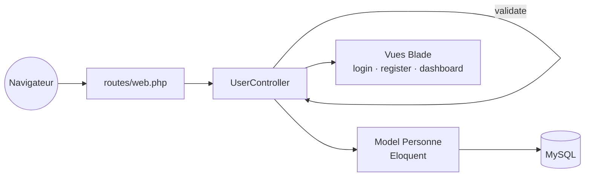

<div align="center">

# Dashboard Laravel

**Application web Laravel 11 avec inscription, connexion et tableau de bord**


</div>

---

## Présentation

Projet d'apprentissage du framework Laravel : une application MVC qui gère l'inscription d'utilisateurs, avec validation des formulaires côté serveur, persistance via Eloquent et des vues Blade stylées avec TailwindCSS.

## Fonctionnalités

- Page de connexion et page d'inscription
- Validation serveur des champs (nom, prénom, âge, email, confirmation du mot de passe)
- Enregistrement des utilisateurs avec Eloquent (`Personne`)
- Messages flash après inscription
- Vues Blade réutilisables (`partials/_form`) : tableau de bord, liste, formulaire, édition
- Migrations versionnées, dont l'ajout d'une colonne sur une table existante

## Architecture



| Route | Méthode | Action |
|-------|---------|--------|
| `/` | GET | Page de connexion |
| `/register` | GET | Formulaire d'inscription |
| `/register` | POST | Validation et création de l'utilisateur |

## Installation

Prérequis : PHP 8.2+, Composer, Node.js, MySQL.

```bash
git clone https://github.com/Russel-Kamgang/Dashboard-With-Laravel.git
cd Dashboard-With-Laravel

composer install
npm install

cp .env.example .env
php artisan key:generate
# Renseigner DB_DATABASE, DB_USERNAME et DB_PASSWORD dans .env

php artisan migrate
npm run dev        # dans un terminal
php artisan serve  # http://localhost:8000
```

## Structure

```
app/
├── Http/Controllers/     # UserController, AdminController
└── Models/               # Personne, Utilisateur, User
database/migrations/      # Schéma de la base
resources/views/          # Vues Blade
routes/web.php            # Routes de l'application
```

## Feuille de route

- [ ] Authentification complète (sessions, middleware `auth`)
- [ ] CRUD des utilisateurs depuis le tableau de bord
- [ ] Tests fonctionnels avec PHPUnit
- [ ] Conteneurisation avec Docker Compose (PHP-FPM, Nginx, MySQL)

## Licence

Code sous licence [MIT](https://opensource.org/licenses/MIT), comme le framework Laravel.
